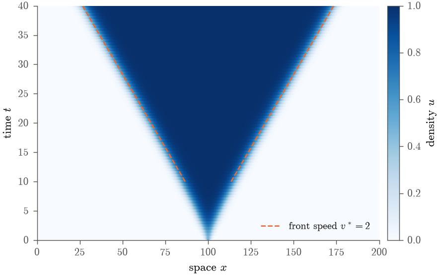
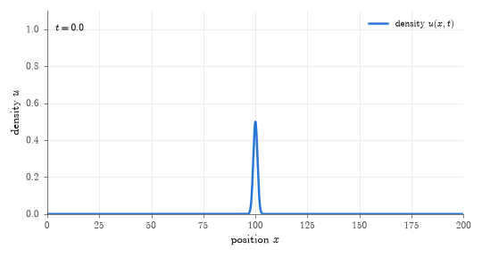

# Reaction-Diffusion Population Dispersal

MAC-F314 Mathematical Modelling, Problem Statement 11, BITS Pilani, Hyderabad Campus.

A reproducible study of a central population drop spreading under logistic growth and diffusion. The project derives the model from conservation and Fick's law, implements the required nested spatial and temporal loops, and compares measured wave speeds with Fisher-KPP theory.

**[Download the project report](submission/Reaction_Diffusion_Project_Report.pdf)**. It contains typed mathematical derivations, explained figures, reproduction instructions, and the complete programming code in Appendix A.

## Model and numerical method

$$\frac{\partial u}{\partial t}=D\frac{\partial^2u}{\partial x^2}+ru\left(1-\frac{u}{K(x)}\right).$$

For constant positive parameters on an unbounded habitat, steep initial data select the asymptotic speed $v^*=2\sqrt{rD}$. Finite-time simulations approach that value slowly. We use central spatial differences and forward Euler time stepping, with mirror ghost nodes for no-flux boundaries. The reference solver uses explicit nested Python loops; the array solver uses the same update for longer experiments.

The baseline has $D=r=K=1$, $L=200$, $\Delta x=0.2$, $\Delta t=0.0025$, and a Gaussian drop of amplitude 0.5 and width 1. Its fitted front speed on $20\le t\le40$ is approximately 1.9473, versus the limiting continuum speed 2. The report separates finite-time relaxation from the speed bias of the discrete scheme.





## Reproduce

Python 3.10 or later is required. The scientific dependency ranges are in [requirements.txt](requirements.txt); [requirements-tested.txt](requirements-tested.txt) records the exact versions used for the delivered regeneration on Python 3.14.4. The latter snapshot is specific to that runtime; use the regular requirements on older Python versions.

```bash
git clone https://github.com/awmbw/Reaction-Diffusion-Population-Dispersal.git
cd Reaction-Diffusion-Population-Dispersal
python -m venv .venv
source .venv/bin/activate          # Windows: .venv\Scripts\activate
python -m pip install -r requirements.txt
python -m pytest tests -q
python run_all.py
```

The pipeline regenerates all experiments, **19 figures in both PNG and PDF**, **two GIF animations**, baseline front data, and the LaTeX result macros and tables. Runtime depends on the machine. The stability experiment deliberately uses an unsafe step to demonstrate overflow; nonfinite values in that experiment are expected.

```bash
make test
make outputs
make report                      # TeX Live with latexmk
# alternatively:
make report-tectonic              # portable Tectonic compiler
```

For the TeX Live route on Ubuntu/Debian, install `latexmk`, `texlive-latex-extra`, `texlive-fonts-recommended`, and `texlive-pictures`. Tectonic downloads its TeX packages on first use. Without Make, run `tectonic report.tex` from `report/`, then copy `report/report.pdf` to `submission/Reaction_Diffusion_Project_Report.pdf` from the repository root. Rebuild after rerunning the experiments so the report reflects the regenerated tables and timings.

## Files

| Path | Purpose |
| --- | --- |
| [rdpop/solver.py](rdpop/solver.py) | Reference nested loops, array engine, grid and input validation |
| [rdpop/theory.py](rdpop/theory.py) | Fisher speed, discrete dispersion, exact wave, critical patch |
| [rdpop/analysis.py](rdpop/analysis.py) | Interpolated front positions, fits, mass and error norms |
| [rdpop/experiments.py](rdpop/experiments.py) | All experiments and their parameters |
| [rdpop/figures.py](rdpop/figures.py) | Every report figure |
| [rdpop/animations.py](rdpop/animations.py) | Animated line plots |
| [rdpop/report_data.py](rdpop/report_data.py) | Generated report macros, tables, JSON and CSV |
| [run_all.py](run_all.py) | Complete reproduction pipeline |
| [tests/](tests/) | Numerical checks and solver regression tests |
| [report/](report/) | Editable LaTeX source; code is included directly from source files |
| [outputs/](outputs/) | Generated images, animations and data |
| [submission/](submission/) | Final report, including the complete code appendix |

## Experiments and limits

The experiments cover symmetric spreading, long-time speed relaxation, a 16-pair $(r,D)$ sweep, initial-tail speed selection, coupled space-time refinement and fixed-grid temporal convergence, mass conservation, reaction-aware stability, variable carrying capacity, and lethal-edge critical patch size.

Lower carrying capacity limits the eventual density but leaves the low-density growth rate positive. Lethal Dirichlet edges produce a persistence threshold $L_c=\pi\sqrt{D/r}$; positive equilibria require $L>L_c$. This is a distinction between the models studied, not a claim that every real invasion needs lethal boundaries to be stopped.

Traveling-wave results apply before finite-domain boundaries affect the fronts. A fitted regression standard error is not a full uncertainty bound on the physical speed. The model uses scaled units and has no species-specific calibration.

## Authors

Diya Patel, Abhiram Dodla, Aum Vijay Bawiskar, Divyanu Singh, Anshuman Singh, Druhin Sourya Datta Bommisetti, and Akash Tejas Jog. Student IDs are on the report title page.

The report contains the full bibliography, including Fisher (1937), Kolmogorov, Petrovsky and Piskunov (1937), Bramson (1983), and van Saarloos (2003).
